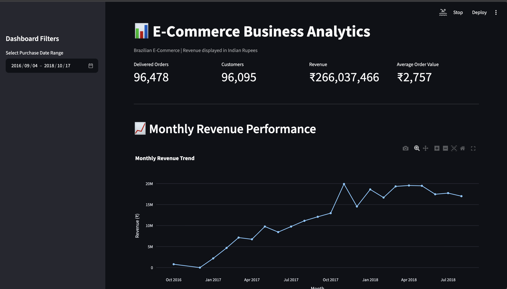
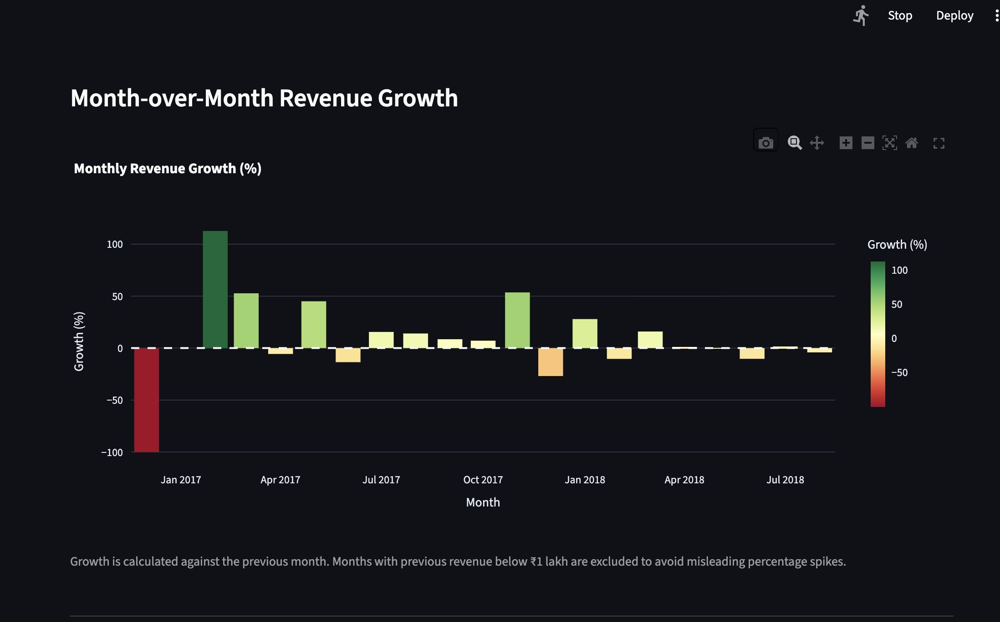
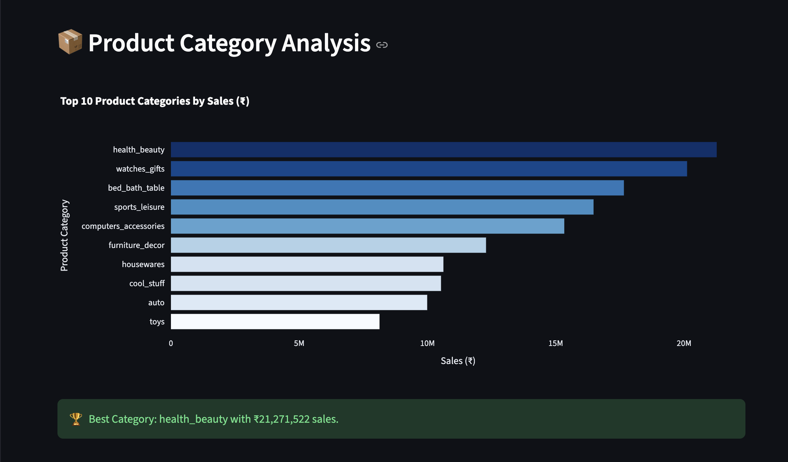
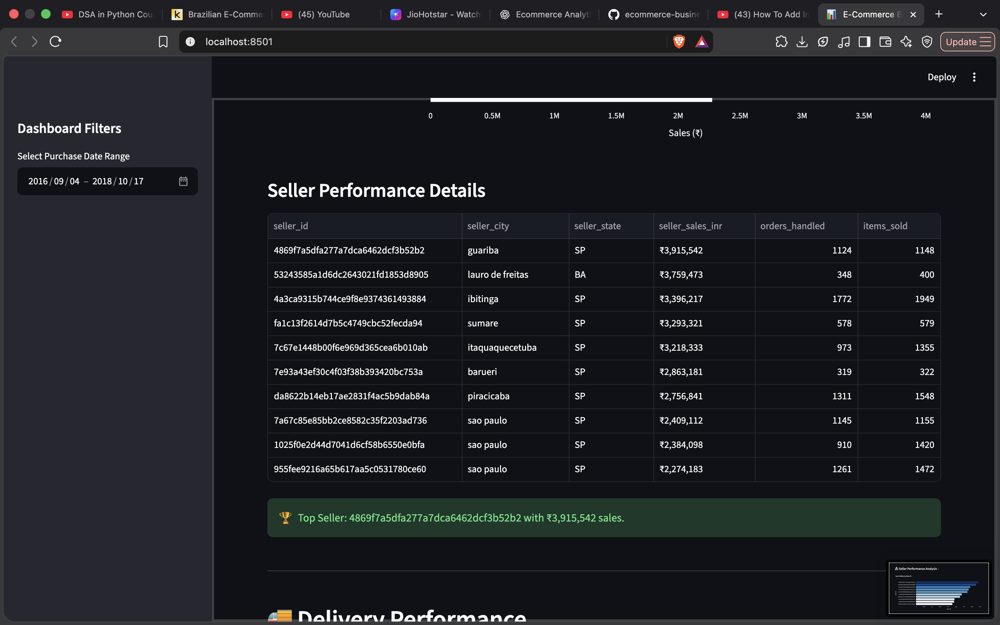
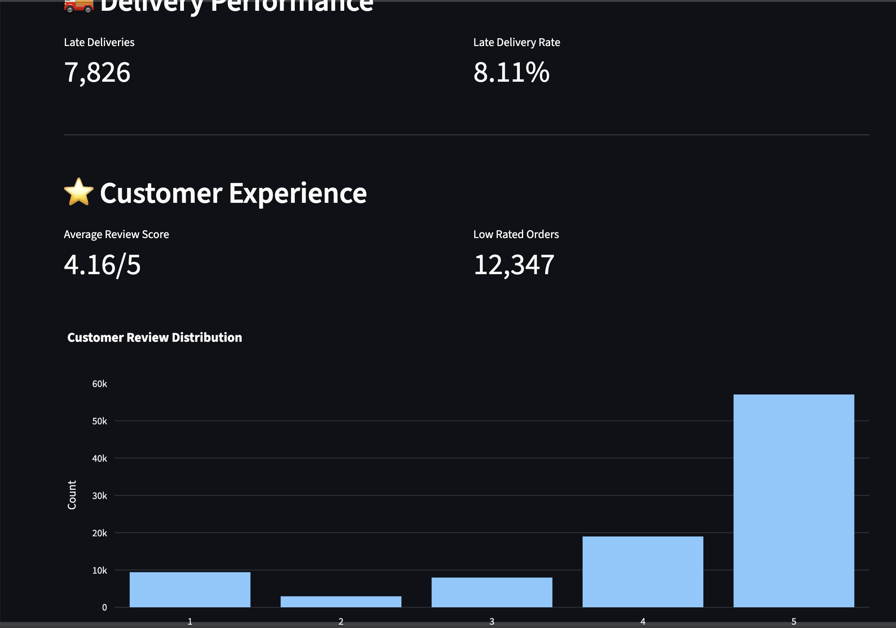
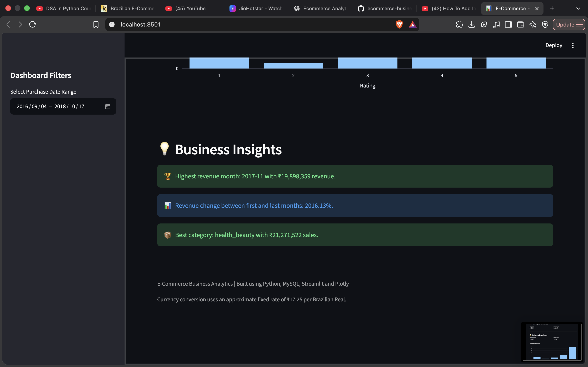

# E-Commerce Business Analytics Dashboard

An end-to-end e-commerce analytics project built using the Brazilian Olist dataset. This project explores sales performance, customer behaviour, product categories, seller performance, and delivery operations through SQL analysis and an interactive Streamlit dashboard.

## Dashboard Preview



## Business Objectives

- Analyse overall sales and revenue performance.
- Identify top-performing product categories.
- Understand customer purchasing patterns.
- Evaluate seller performance.
- Analyse delivery performance and customer reviews.
- Track monthly revenue trends.

## Tech Stack

- **Python** – Data processing and dashboard development
- **MySQL** – Data storage and SQL analysis
- **Pandas** – Data manipulation
- **Streamlit** – Interactive dashboard
- **Plotly** – Data visualisation
- **Git & GitHub** – Version control

## Key Dashboard Metrics

| Metric | Result |
|---|---:|
| Delivered Orders | 96,478 |
| Customers | 96,095 |
| Revenue | ₹266,037,466 |
| Average Order Value | ₹2,757 |

*Values shown are from the dashboard screenshot and may depend on the selected date range.*

## Key Business Insights

- Health and Beauty was the highest-selling product category in the category analysis, with approximately ₹21.27 million in sales.
- Monthly revenue increased substantially during the period shown in the dashboard.
- The dashboard provides separate views for category analysis, seller performance, customer experience, and monthly revenue.

## Dashboard Analysis

### Monthly Revenue


### Product Category Analysis


### Seller Performance


### Customer Experience


### Business Insights


## Currency Conversion

The original dataset uses Brazilian Real (BRL). For easier interpretation, revenue is displayed in Indian Rupees (INR), using an approximate fixed conversion rate of ₹17.25 per BRL.

## Project Structure

```text
ecommerce-analytics/
├── app/
│   └── dashboard.py
├── data/
│   └── raw/
├── reports/
│   ├── dashboard_overview.png
│   ├── monthly_revenue.png
│   ├── category_analysis.png
│   ├── seller_performance.png
│   ├── customer_experience.png
│   └── business_Insights.png
├── scripts/
├── sql/
│   └── 01_business_analysis.sql
├── .gitignore
├── README.md
└── requirements.txt
```

## How to Run

1. Clone this repository.
2. Create and activate a Python virtual environment.
3. Install dependencies using `pip install -r requirements.txt`.
4. Configure your local MySQL database and connection settings.
5. Run the dashboard:

```bash
streamlit run app/dashboard.py
```

## Dataset

Brazilian E-Commerce Public Dataset by Olist.

## Author

**Ujjwal Pandey**  
B.Tech – Information Technology
